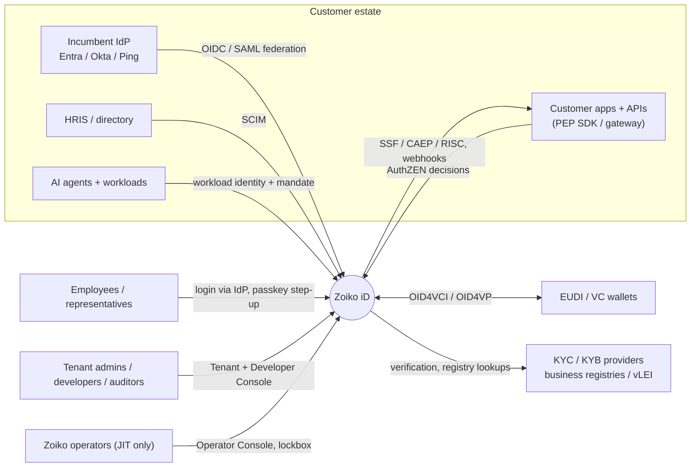
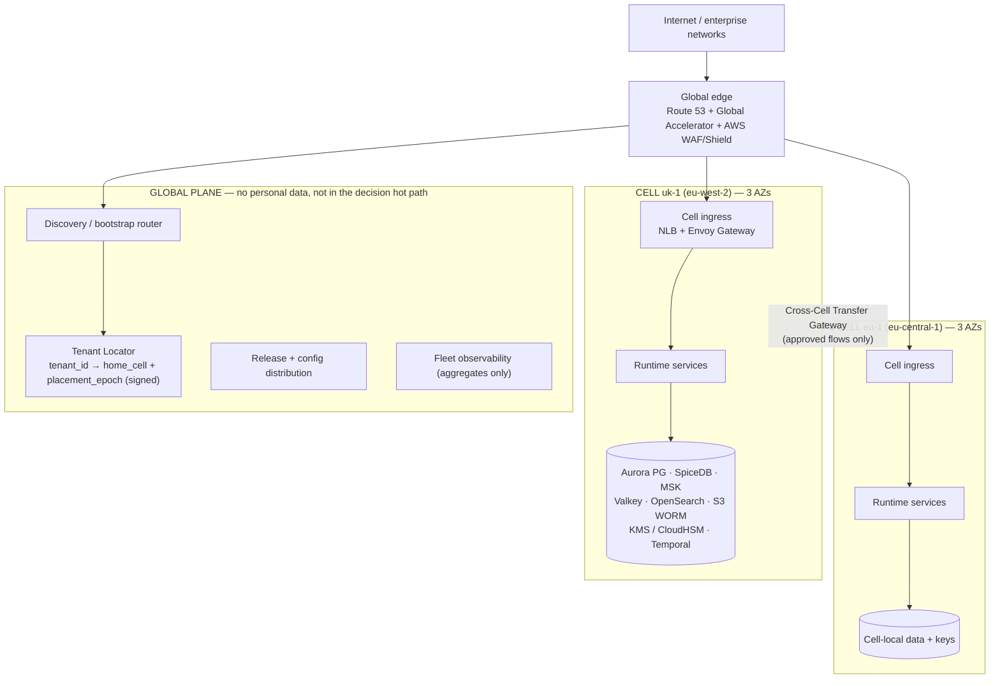
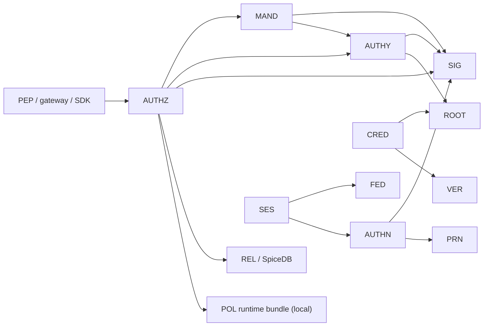
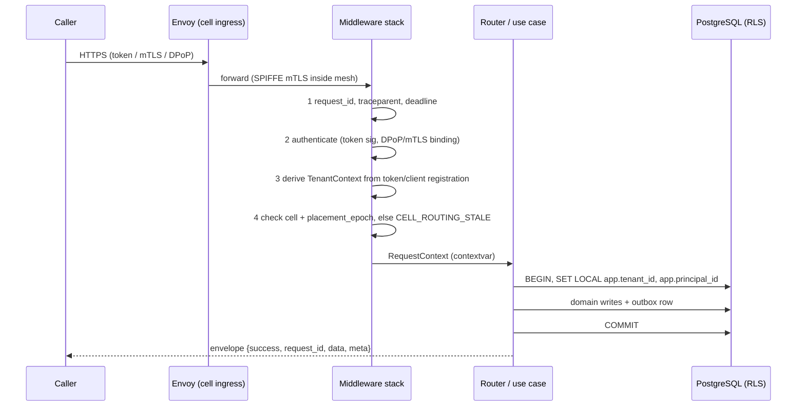
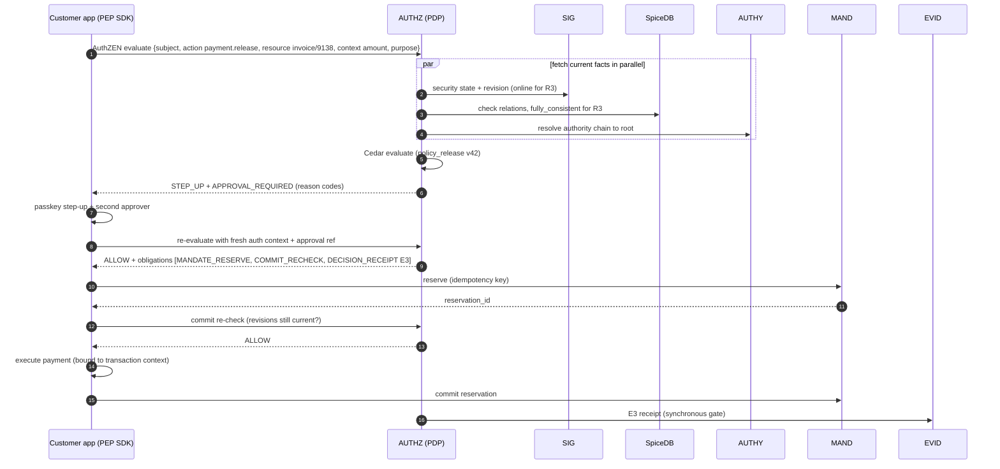
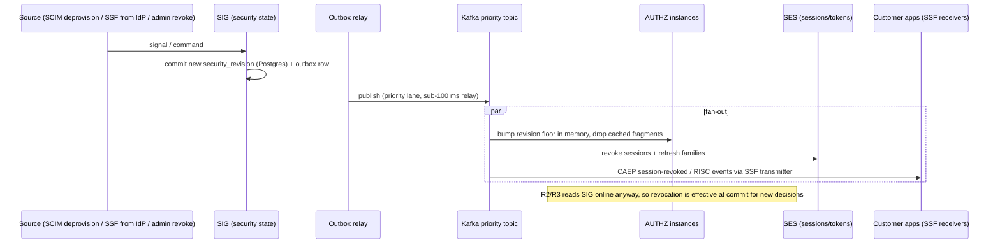
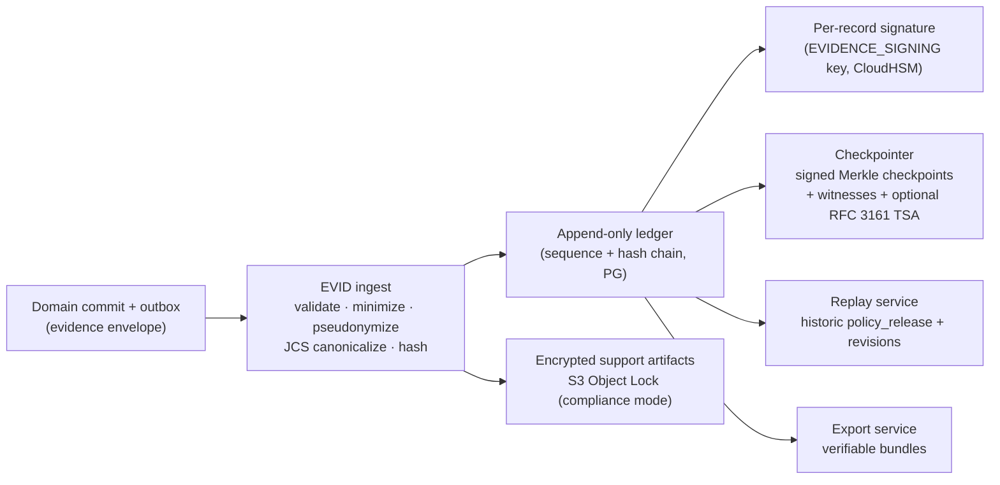

# Zoiko iD — Solution Architecture

| Field | Value |
|---|---|
| Document ID | ZID-SAD-001 |
| Version | 0.1 |
| Status | **Draft — for Architecture Review Board** |
| Date | 10 October 2026 |
| Derived from | Canonical specs 01–25 (Back-End Target Architecture v2.0 is the master baseline) |
| Decisions | [docs/phases/](../phases/README.md): grouped by build phase A–I (`DEC-<phase><n>`); the ten spec baseline decisions ADR-01 to ADR-10 are listed in its baseline register |
| Audience | Backend, frontend, platform, security, SRE, QA and data engineering |

This document turns the 25 canonical specifications into one buildable architecture on the agreed stack (Python/FastAPI, Next.js, PostgreSQL, SpiceDB, Cedar, Kafka, AWS). Where the specs already fix a rule, this document cites it and shows how we implement it. Where the specs leave a choice open, the choice is made here and recorded as a decision in the matching phase file ([docs/phases/](../phases/README.md)).

If this document contradicts an approved canonical spec, the spec wins and this document must be corrected.

---

## 1. Scope and goals

Zoiko iD is an overlay-first trust layer: identity, verification, credentials, organizational authority, delegated mandates, AI-agent identity, continuous revocation and decision evidence. Customers keep their incumbent IdP (Entra, Okta, Ping).

The architecture must make these five things true at the same time:

1. **Correct authority.** No ALLOW without a complete authority chain to a verified root. No privilege stitching.
2. **Fresh state for risky actions.** R2/R3 decisions use current authoritative state and fail closed.
3. **Fast revocation.** R0 ≤15 min, R1 ≤60 s, R2 ≤10 s, R3 ≤2 s p99 in-cell.
4. **Defensible evidence.** Material decisions produce signed, replayable DecisionReceipts that survive privacy erasure.
5. **Residency and tenant isolation.** These hold end to end, including caches, logs, backups and keys.

## 2. Architecture drivers

### 2.1 Quality targets (Stage A)

| Driver | Target | Source |
|---|---|---|
| Authorization latency | p95 <40 ms (R0/R1), <60 ms (R2/R3), regional | NFR spec |
| Policy evaluation budget | ≤10 ms R0/R1, ≤15 ms R2/R3 | Authz spec |
| Relationship read budget | ≤10 ms R0/R1, ≤15 ms R2/R3 | Authz spec |
| Mandate reserve/commit | ≤15 ms p95, home cell | Mandate spec |
| Gateway/auth context | ≤10 ms p95 | NFR spec |
| Throughput | 20k decisions/s global, 5k/s per cell, 10k token issuances/s, 2k R2/R3 receipts/s | Arch §17 |
| Qualification | Sustained 2× Stage A | Arch §17, Readiness plan |
| Availability | 99.995% for critical trust paths (~26 min/yr) | Deployment spec |
| DR | RTO ≤15 min for a core cell; RPO per data class | Arch §16 |
| Principals | 10M | Arch §17 |

### 2.2 Risk classes drive runtime behavior

| Class | Revocation | Decision state | On dependency failure |
|---|---|---|---|
| R0 | ≤15 min | Bounded cache allowed | May use cached facts |
| R1 | ≤60 s | Bounded cache + revision check | Policy-defined |
| R2 | ≤10 s | Online current state | **Fail closed** |
| R3 | ≤2 s p99 in-cell | Online PDP + commit re-check + mandate reservation | **Fail closed** |

Every protected action declares its risk class and minimum evidence class in the action catalog. A caller can raise them but never lower them.

### 2.3 Fixed constraints from the specs

- PostgreSQL is the only source of truth. Graph, cache and search are derived and rebuildable.
- Tenant context is derived on the server. Request headers and bodies are routing hints at most.
- Each logical service owns its schema. There are no cross-service joins and no shared mutable ORM models.
- Events use a transactional outbox, with no dual writes. Delivery is at-least-once, with idempotent consumers.
- Synchronous runtime dependencies must be acyclic.
- Mandates have a single writer in the home cell, with fencing.
- No static machine secrets. Workload identity uses SPIFFE, with mTLS.
- The global plane holds no personal data.
- Use standards (OAuth/OIDC, WebAuthn, AuthZEN, SSF/CAEP/RISC, OID4VC). Draft protocols stay behind adapters.

---

## 3. System context



---

## 4. Deployment topology: global plane and cells

### 4.1 Shape



### 4.2 Rules

- **The cell is the blast-radius unit.** Each cell holds all the runtime, data, keys, telemetry and evidence its tenants need, and keeps working if the global plane is lost.
- **Inside a cell:** stateless tiers run active-active across 3 AZs (N+2 replicas), and stateful tiers use quorum across AZs.
- **Global plane contents:** opaque tenant IDs, the home cell, placement epoch, release metadata and aggregate health. It never stores names, emails, domains or evidence.
- **No multi-region writers.** Moving a tenant or failing over uses `placement_epoch` fencing. A stale-epoch write is rejected with `CELL_ROUTING_STALE` or `CELL_NOT_AUTHORITATIVE`.

### 4.3 Routing (DEC-G3)

The global edge is used for **bootstrap and discovery**, not for every request.

1. An SDK, PEP or browser calls discovery (`https://api.id.zoiko.com/.well-known/...`, or a tenant alias host).
2. Discovery resolves the tenant through the Locator and returns the **cell endpoint** (for example `uk-1.api.id.zoiko.com`) plus the `placement_epoch`. The response is signed and cacheable with a bounded TTL.
3. Runtime traffic then goes **directly to the cell**. Tokens carry signed `tid`/`cell` claims, and the cell ingress validates them again.
4. On failover or migration the old cell returns `CELL_ROUTING_STALE` with the new location, and SDKs re-discover.

This keeps the global plane out of the R2/R3 hot path, as the specs require, and removes an extra hop from every decision.

### 4.4 Stage A launch topology (proposal)

| Item | Proposal |
|---|---|
| Production cells | `uk-1` (London) and `eu-1` (Frankfurt) |
| Global plane | Small footprint in one region with a warm standby. It is only a locator, so losing it does not stop routed traffic. |
| Sovereign / dedicated (SRP-2/3) | Not in Stage A (wave W6) |
| **Open question** | AWS has only one UK region. For SRP-1 UK tenants, either recovery stays multi-AZ inside London only (RTO bounded by in-region recovery), or the tenant contract approves `eu-1` as recovery cell. Legal and the residency owner must decide this before G4. |

---

## 5. Planes inside a cell

| Plane | Contains | Availability rule |
|---|---|---|
| Data plane | Authentication, authorization, verification, mandates, protected APIs | Highest; operates locally |
| Security plane | Revocation, security state, signals, emergency deny | Priority lane; never starved by bulk work |
| Evidence plane | Receipts, audit, checkpoints | Durable; E3 can be a synchronous gate |
| Control plane | Tenant config, policy publishing, admin APIs | May be down without stopping runtime |
| Management plane | CI/CD, IaC, operator access | No runtime dependency; JIT/lockbox |
| Analytics plane | Reporting, metering aggregates | Failure never affects decisions |

Kubernetes enforces these planes with **separate node pools and PriorityClasses**:

| Node pool | Runs | Priority |
|---|---|---|
| `trust-critical` | Identity, authorization and authority runtimes, plus SIG | Highest |
| `standard` | Trust, integration and console APIs | Normal |
| `workers` | Outbox relays, consumers, Temporal workers, projections | Normal, preemptible |
| `system` | Mesh, SPIRE, observability agents | System |

Under pressure the cluster sheds non-critical work first (bulkhead rule, Service spec §19).

---

## 6. Logical services in a modular monolith (DEC-D6)

The specs define **27 logical services**. Stage A ships them as **one modular monolith**: one package (`zoiko-id-platform`), one image, one release. Each logical service is a **module** with its own `ports.py` interface, its own tables and its own migration stream, so any module can be extracted later (Service spec §4: *"no microservice dogma… an early modular deployment is acceptable"*).

| Plane | Modules (logical services) | Tables live in schemas | Notes |
|---|---|---|---|
| **Runtime** | principal (PRN), authentication (AUTHN), session (SES), decision (AUTHZ), policy_runtime (POL runtime), relationship (REL), authority (AUTHY), mandate (MAND), machine (MACH) | `core`, `authn`, `authz`, `org`, `agent` | Latency-critical. The decision path is performance-gated (DEC-B3). |
| **Trust** | organization (ROOT), verification (VER), credential (CRED) | `org`, `verify`, `cred` | Provider adapters isolated; CRED may move to Kotlin (DEC-A2) |
| **Security / Evidence** | signals (SIG), evidence (EVID), privacy (PRIV) | `signals`, `evidence`, `privacy` | SIG on the priority lane; EVID never blocks SIG |
| **Integration** | federation (FED), provisioning (SCIM), integration (INT), onboarding (ONB), webhook (WHK) | `authn`, `platform`, `events` | Kept off runtime failure paths |
| **Control / Support** | tenant (TEN), configuration (CFG), policy_authoring (POL), operator_access (OPS), metering (METER), notification (NOTIF), search (SEARCH) | `platform`, `authz`, `metering` | Never on the R2/R3 path |
| **Global** | locator, discovery | `global_directory` (separate database) | Served only by the `global` role |

**Run modes of the single image:**
- **Role** (`ZID_ROLE`): `cell` loads the 27 cell modules and is deployed once per regional cell. `global` loads only `locator` and `discovery`, on the global-plane database with no personal data.
- **Process:** the API is the default. `consumer` (Kafka consumers, for example the relationship projector into SpiceDB), `worker` (Temporal workflows, for example onboarding sagas and the evidence checkpointer) and `outbox_relay` run as separate processes of the same image.
- **Hot-path protection:** separate connection pools and worker limits per plane inside the process. When load requires it, runtime and admin routes go to separate replica pools of the same image (DEC-D6 §4).

**Third-party engines run as services:** SpiceDB, Temporal, SPIRE, Envoy Gateway, OpenBao.

### 6.1 Synchronous dependency rules (must stay acyclic)



- AUTHY never calls MAND. AUTHZ never calls SEARCH, METER, NOTIF or ONB.
- EVID receives evidence from every domain but is not read on the ordinary decision path.
- CI enforces these rules: architecture tests (`backend/app/tests/unit/test_architecture.py`) reject any cross-module import that bypasses `ports.py`, and the interface registry records declared dependencies.

---

## 7. Inside the monolith

### 7.1 Module layout (hexagonal)

Every module has the same four layers:

```
backend/app/
  src/zid_platform/
    main.py                  # FastAPI app factory: composes the role's modules, middleware, lifespans
    roles.py                 # cell | global role -> modules + schemas; plane grouping
    entrypoints/             # api · consumer · worker · outbox_relay (same image, separate processes)
    modules/
      mandate/
        api/                 # FastAPI routers, request/response Pydantic models (public + internal)
        application/         # use cases / command handlers; transaction boundaries live here
        domain/              # pure Python: aggregates, state machines, invariants, reason codes
        infrastructure/      # SQLAlchemy repositories, outbox writer, clients to other modules
        ports.py             # Protocol interfaces this module exposes to other modules
      authority/ ... (29 modules in total)
  migrations/<module>/       # one Alembic stream per owning module
  tests/ (unit · property · component · contract)
```

- **`domain/` has no I/O imports.** No FastAPI, SQLAlchemy or httpx. Authority algebra and mandate invariants live here, so Hypothesis property tests run fast and deterministically.
- **Modules talk only through `ports.py`.** Each module exposes a `Protocol`. Inside the monolith the implementation is an in-process adapter. If a module is extracted later, the same Protocol is backed by an HTTP client, and callers don't change.
- **No shared ORM entities.** Each module has its own SQLAlchemy models bound to its own schema.

### 7.2 Request lifecycle



### 7.3 Shared platform libraries (`backend/libs/`)

These libraries make the non-negotiable rules the default path, so engineers can't forget them.

| Library | Responsibility | Spec rule enforced |
|---|---|---|
| `zid-context` | `RequestContext` (tenant, cell, epoch, principal, actor chain, purpose, deadline, risk class) in contextvars; deadline propagation | Server-derived tenant; deadlines never extended |
| `zid-db` | Async engine/session factory. Transactions **always** start with `SET LOCAL` tenant/principal. Refuses to run tenant-scoped queries without context. Pool reset on checkout. | RLS, no BYPASSRLS, no caller-set context |
| `zid-outbox` | `UnitOfWork.add_event(...)` writes CloudEvents rows in the same transaction; inbox dedup helper for consumers | No dual writes, idempotent consumers |
| `zid-idempotency` | `Idempotency-Key` storage (tenant + operation + caller + key), request fingerprint, result replay, 409 on mismatch | API spec idempotency |
| `zid-errors` | Canonical error codes and envelopes; maps domain errors to HTTP 401/403/409/412/422/429/503 | API spec §3 |
| `zid-authz-client` | PEP SDK used by our own services: AuthZEN call, obligation handling, commit re-check | "Service performing the effect is the final PEP" |
| `zid-evidence` | Typed evidence envelopes (E1–E3), canonical JSON (JCS), sent via outbox or a synchronous E3 gate | Evidence by design |
| `zid-crypto` | Crypto broker: KMS/HSM calls, envelope encryption (AES-256-GCM with AAD), algorithm allowlists, JWS/JWT helpers | Crypto spec locks |
| `zid-telemetry` | OpenTelemetry setup, PII-safe structured logging, standard metrics | Observability contract |
| `zid-testing` | testcontainers fixtures, golden authority/mandate fixtures, tenant-isolation test helpers | Readiness plan |

---

## 8. Core flows

### 8.1 Protected R3 action (example: release payment on Invoice 9138)



Rules shown above:
- ALLOW means "may proceed only if all mandatory obligations are fulfilled". A PEP that can't fulfil an obligation must not act.
- STEP_UP, APPROVAL_REQUIRED and STATE_UNAVAILABLE are separate outcomes, never ALLOW.
- If SIG, REL, AUTHY or MAND is unavailable or stale for R3, the outcome is DENY or STATE_UNAVAILABLE. It is never allow-by-default.

### 8.2 AI agent acting under a mandate

1. The agent workload presents its SPIFFE SVID or cloud workload identity. MACH resolves the workload to the agent principal and validates the runtime binding and attestation.
2. The token exchange (RFC 8693) issues an audience-bound, sender-constrained token carrying the actor chain plus a **Transaction Context Envelope** reference: agent → sponsor → represented principal → mandate → action.
3. The PDP evaluates the attenuated grant, mandate constraints (tool, purpose, data, value, budget) and the TOOL_ALLOWLIST obligation.
4. The ledger runs reserve → execute → commit, or release. Crashes are reconciled from the reservation state (§10).
5. A receipt is produced. Signals about agent compromise flow through the priority lane (§8.3).

### 8.3 Revocation propagation (R3 ≤2 s)



- **Signals can revoke but never grant.**
- R2/R3 decisions never rely on propagation. They read current SIG state at decision time, which is why R3 can meet 2 s even if a consumer lags.
- Propagation latency is measured end to end, from commit to consumer apply, and is an SLO.

### 8.4 Enterprise onboarding (Temporal saga)

The onboarding states are DRAFT → ORGANIZATION_VERIFYING → CONFIGURING → INTEGRATING → SHADOW → PILOT → ACTIVE. Each step calls the authoritative owner service (TEN, FED, SCIM, INT, ROOT/VER, AUTHZ shadow) and records the immutable ID and version it returns. A failure compensates only resources the saga itself provisioned. Committed evidence is never deleted. In **shadow mode** the decision service evaluates but doesn't enforce, and the console shows where Zoiko's decisions differ from current behavior.

### 8.5 Login through the incumbent IdP (overlay O1/O2)

1. The app redirects to the Zoiko issuer. Hosted login (Next.js) asks the identity runtime for the tenant's routing policy.
2. The user is federated to Okta or Entra using OIDC (Authorization Code + PKCE) or SAML.
3. The callback is validated (issuer, audience, nonce, signature against an algorithm allowlist). The external identity key is `issuer + sub`, never email.
4. The account-linking rules resolve the canonical principal.
5. SES issues a session and tokens (short-lived, sender-constrained). Passkey step-up is used when policy requires it.

---

## 9. Authorization engine (PDP)

### 9.1 Evaluation pipeline

| Step | Work | Budget (R2/R3) |
|---|---|---|
| 1 | Parse and validate the AuthZEN request; resolve the action catalog entry (risk class, evidence class, required facts) | 1 ms |
| 2 | Resolve subject, actor chain and represented principal | 2 ms |
| 3 | Fetch facts **in parallel** (`asyncio.gather`): SIG state, SpiceDB checks, AUTHY chain, MAND status, assurance | ≤15 ms (critical path) |
| 4 | Build Cedar entities and context; evaluate with `cedarpy` against the compiled policy bundle in memory | ≤15 ms |
| 5 | Compose outcome, reason codes, obligations and observed revisions | 1 ms |
| 6 | Write the decision record + outbox (E2), or call the E3 gate | ≤5 ms async / sync E3 |
| | **Total p95** | **<60 ms** |

### 9.2 Policy (DEC-C3)

- Policies are written in **Cedar**, with a schema per tenant built from the action and resource catalog.
- The policy service (the `policy_authoring` module) validates releases (schema typing, Cedar static analysis, property tests, conflict checks), freezes them, and publishes **immutable compiled bundles** identified by `policy_release_id`.
- Decision instances load bundles from POL and cache them by ID. Since bundles are immutable, the cache is always safe.
- Lifecycle: DRAFT → VALIDATING → REVIEW → SCHEDULED → ACTIVE → RETIRED / REVOKED. Shadow evaluation and simulation run on the same engine.
- **Authority algebra is enforced in code before Cedar evaluation.** AUTHY returns only complete, attenuated chains. Cedar never composes partial grants (no privilege stitching).

### 9.3 Relationship consistency by risk class (DEC-C4)

| Risk | SpiceDB consistency | If the projection is behind the required `relation_revision` |
|---|---|---|
| R0 | `minimize_latency` | Accept within bound |
| R1 | `at_least_as_fresh` (token from the caller or the latest known) | Accept within bound |
| R2 | `at_least_as_fresh` (latest committed ZedToken recorded by REL) | Short bounded wait, then `AUTHORITY_STALE` |
| R3 | `fully_consistent` | `STATE_UNAVAILABLE`; deny |

### 9.4 Caching

- Decision fragments may be cached in-process or in Valkey **only for R0/R1**. Cache keys are tenant-qualified and include all observed revisions, and the bounded TTL is invalidated by revision bumps from the priority lane.
- **No cached ALLOW is ever used for R2/R3.**

---

## 10. Mandate ledger (DEC-C5)

The mandate ledger is the only consumable-authority store. It has a single writer per mandate in its home cell.

**Tables** (schema `agent`): `mandate`, `mandate_budget` (limit, consumed, reserved, currency or unit), `mandate_reservation` (`status` ∈ RESERVED/COMMITTED/RELEASED/EXPIRED, `amount`, `expires_at`, `idempotency_key`, `execution_id`) and `writer_fence` (`tenant_id`, `epoch`).

**Reserve** runs in one transaction:
1. Check the fence: `SELECT epoch FROM agent.writer_fence WHERE tenant_id = :t FOR SHARE`. If it doesn't equal the service's epoch, abort with `CELL_NOT_AUTHORITATIVE`.
2. Insert the reservation with `ON CONFLICT (tenant_id, idempotency_key) DO NOTHING RETURNING id`. If there's a conflict, return the existing reservation (same fingerprint) or 409 (different fingerprint), and stop.
3. Run a conditional update:
   ```sql
   UPDATE agent.mandate_budget
      SET reserved = reserved + :amount, row_version = row_version + 1
    WHERE tenant_id = :t AND mandate_id = :m AND budget_key = :k
      AND consumed + reserved + :amount <= limit_amount
   RETURNING row_version;
   ```
   If zero rows are updated, roll back and return `MANDATE_LIMIT_EXCEEDED`.
4. Check mandate status, validity window and grant continuity (from AUTHY, read before the transaction and re-checked by revision).
5. Write the outbox event `mandate.reservation.created.v1` and commit.

**Commit** moves `reserved` to `consumed` for that reservation. **Release** returns it. An **expiry sweeper** releases stale reservations. **Reconciliation** runs for ambiguous external effects, using `execution_id` with the tool or provider.

Why this design: a conditional update on one row is atomic in PostgreSQL. Concurrent reserves serialize on the row lock, can never overspend, and don't need SERIALIZABLE retry storms. It is proven by the P0-03 gate: a 10k-concurrency test with crash injection must never exceed the bound and must fully reconcile afterwards.

---

## 11. Data architecture

### 11.1 PostgreSQL (Aurora PostgreSQL, DEC-D1)

- **One Aurora cluster per cell at Stage A**, with tenant-aware partitioning. SpiceDB, Temporal and evidence metadata get their own clusters, so their load can't starve the trust kernel.
- **Schema per module** (`platform`, `core`, `org`, `authn`, `verify`, `cred`, `authz`, `agent`, `privacy`, `evidence`, `signals`, `events`, `metering`). Each has its own runtime role (`svc_identity`, `svc_mandate`, …). Runtime roles never own tables and never have `BYPASSRLS`. Migrations run under `db_owner_migration`, which has no runtime credentials.
- **Conventions:**
  - UUIDv7 primary keys
  - `tenant_id` on every tenant-owned row
  - Tenant-scoped unique indexes `(tenant_id, …)`
  - `timestamptz` in UTC
  - `row_version`, `security_revision` and `relation_revision` columns
  - **Bitemporal** security facts (`valid_from/valid_to` plus `recorded_at/superseded_at`)
  - `numeric(38,9)` plus currency for money
  - JSONB only for provider envelopes and extensions, never for authority or quota arithmetic
- **RLS:** `FORCE ROW LEVEL SECURITY` with `tenant_id = current_setting('app.tenant_id')::uuid`. The context is set only by `zid-db` after authentication.
- **Partitioning:** decisions, receipts, signals and outbox history are range-partitioned by time. Hash sub-partitioning by tenant comes at Stage B.
- **Ownership is per table:** schemas are Data Model namespaces, and each table has exactly one owning module ([table-ownership.yaml](../../backend/database/table-ownership.yaml)). Per-service DB roles get table-level grants.
- **Migrations:** Alembic, one migration stream per owning module (version tables in `zid_migrations`), expand → migrate → contract. N and N-1 app versions must both work during a rollout.

### 11.2 Consistency classes

| Class | Data | Consistency | Store |
|---|---|---|---|
| C0 | Cache, search, analytics | Eventual, rebuildable | Valkey, OpenSearch |
| C1 | Profiles, config, read-mostly | Read-after-write / bounded staleness | PG (+ replicas) |
| C2 | Sessions, security state, relationships | Strong for protected use | PG primary, SpiceDB with tokens |
| C3 | Mandate budgets, writer epochs, root-critical state, evidence commit metadata | Serializable / single writer | PG primary only |

### 11.3 Derived stores

| Store | Built from | Never used for |
|---|---|---|
| SpiceDB | `org.relationship_edge` via outbox → `rel-projector` | Writing canonical authority |
| Valkey | Read-through fragments with tenant-qualified keys | R2/R3 truth |
| OpenSearch | Event projections, per-tenant filter injected by the service | Authorization |
| Admin dashboards | Read models with freshness timestamps | Writes |

---

## 12. Event architecture (DEC-D2)

- **Backbone:** Amazon MSK (Kafka) per cell. Topics are named `zid.<env>.<cell>.<domain>.<class>`.
- **Envelope:** CloudEvents 1.0 with Zoiko extensions (`tenantid`, `cellid`, `correlationid`, `causationid`, `aggregateversion`, `classification`, `evidenceclass`). Event types are `com.zoiko.id.<domain>.<noun>.<past-tense>.v<major>`. AsyncAPI 3.1 is the contract source, with an Apicurio schema registry and BACKWARD compatibility by default.
- **Lanes:**

  | Lane | Carries | Isolation |
  |---|---|---|
  | `priority` | Security signals, revocations, revision bumps | Dedicated topics, consumer pools and relay workers |
  | `domain` | Ordinary domain facts | Standard |
  | `evidence` | Evidence envelopes to EVID | Durable, high min-ISR |
  | `integration` | Sanitized events for webhooks/SSF | Standard |

- **Outbox relay (Stage A):** a polling relay using `SELECT … FOR UPDATE SKIP LOCKED`. The partition key is the aggregate ID, and the idempotent Kafka producer reuses the outbox `event_id`. Debezium/CDC is an option at Stage B.
- **Consumers:** an inbox table keyed by `event_id` plus the highest applied `aggregate_version`. Only retry-safe handlers retry. The DLQ stays in the same cell with the same classification.
- **Webhooks (WHK):** RFC 9421 HTTP message signatures, retry with backoff, and per-endpoint circuit breakers. A 2xx response acknowledges delivery, not business correctness.
- **SSF/CAEP/RISC** are a separate standards channel and are never replaced by generic webhooks.

---

## 13. Evidence architecture

Decisions: DEC-F1 (evidence privacy), DEC-F2 (ledger and integrity profile).



- **Evidence classes:** E0 telemetry (not evidence), E1 audit, E2 material receipt, E3 defensible transaction (normally used for R3).
- **What receipts contain:** pseudonymous handles and commitments, never raw PII, prompts, documents or tokens. Identity-resolving material is encrypted under `SUBJECT_ERASURE_KEY`s. **Crypto-erasure** destroys those keys, while `record_hash`, signatures and structural replay stay valid.
- **Replay** uses the immutable historical policy release and recorded revisions. It never calls live providers and never performs side effects.
- **Tamper evidence:** a database administrator can't rewrite E2/E3 records undetected, because the hash chain, signed Merkle checkpoints and WORM storage would expose it.

---

## 14. Security architecture

### 14.1 Tenant isolation, layer by layer

| Layer | Control |
|---|---|
| Edge / ingress | Tenant derived from token, client registration or issuer; `X-Zoiko-Tenant-Id` must match the derived tenant or the request is rejected |
| Application | `RequestContext` is required by every repository; object-tenant checks (BOLA tests) |
| Database | RLS `FORCE`, tenant-scoped FKs and uniques, per-service roles |
| Cache / search / objects | Tenant-qualified keys, injected filters, tenant prefixes and bucket policies |
| Messaging | Tenant in the trusted envelope, topic ACLs, same-cell DLQ |
| Keys | Tenant KEKs (K3), with CMK/BYOK for regulated tenants |
| Tests | Cross-tenant escape suite is a release blocker (G2) |

### 14.2 Workload identity and transport

Decision: DEC-F7.

- **SPIRE** issues SVIDs to every pod. **Istio ambient** gives mTLS on every hop, and authorization policies allow only the dependency graph in §6.1.
- **Cloud access** uses EKS Pod Identity (no static AWS keys). **Secrets** come from OpenBao as dynamic, short-lease database credentials per service role.
- **External TLS:** TLS 1.3, with 0-RTT disabled on state-changing endpoints. Hybrid post-quantum TLS where supported.

### 14.3 Keys (mapping the spec's K0–K5 hierarchy to AWS)

Decision: DEC-F5 (keys and secrets); DEC-F6 (post-quantum).

| Spec layer | AWS implementation |
|---|---|
| K0 hardware root | CloudHSM clusters per cell; KMS custom key store backed by CloudHSM |
| K1 platform roots | Evidence/checkpoint root and CA root: CloudHSM, quorum-controlled, offline CA root |
| K2 domain / cell KEKs | KMS keys per purpose per cell (identity, evidence, privacy, backup, tenant-wrap) |
| K3 tenant KEKs | KMS key per tenant (CMK/BYOK via external key store for regulated tenants) |
| K4 DEKs / operational | Generated via `zid-crypto`, stored only wrapped. Token-signing and webhook keys are KMS asymmetric keys. |
| K5 session | TLS / mesh, memory only |

Key purposes are never shared: token-signing, federation, VC issuer, evidence, webhook and CA keys are all separate.

### 14.4 Operator trust

Decision: DEC-F4.

- No human has standing production data access.
- The **OPS** service issues JIT elevation scoped to tenant, object classes, actions, reason, case and expiry, with dual control, plus a **customer lockbox** where the tenant requires it.
- Break-glass access is E3-audited.
- The Operator Console is a separate origin, OIDC client and identity policy.

### 14.5 Supply chain

Decision: DEC-G4.

GitHub Actions with OIDC to AWS (no stored keys). Builds produce SLSA L3 provenance, cosign signatures and Syft SBOMs, and are scanned with Trivy, Semgrep, gitleaks and pip-audit. **Kyverno** admits only signed images with verified provenance in production namespaces. Pre-production and production run the identical artifact digest.

---

## 15. Frontend architecture (DEC-H1)

| App | Users | Origin | Notes |
|---|---|---|---|
| Tenant Console | Customer admins, security, compliance, auditors | `console.id.zoiko.com` | Main admin surface |
| Developer Console | Customer developers | `developers.id.zoiko.com` | Apps, clients, webhooks, sandbox |
| Trust Center | End users / representatives | `my.id.zoiko.com` | Sessions, delegations, consents, credentials |
| Hosted Login | Everyone at login | `id.zoiko.com` | Login, consent, passkey UI; protocol endpoints stay in FastAPI |
| Operator Console | Zoiko staff only | Separate domain + network path | Separate build, OIDC client and policy |

All apps live in one **pnpm/Turborepo workspace** under `frontend/` (`frontend/apps/*`, shared `frontend/packages/{ui,api-client,auth-bff,config}`). Routes follow the UI/UX Wireframes navigation; see [repository-structure.md §3](repository-structure.md).

- **Next.js only shows screens; it never makes access decisions.** Every mutation is re-authorized in FastAPI. Hiding a button in the UI is cosmetic.
- **Thin BFF:** the browser holds only an httpOnly, Secure, SameSite cookie bound to a server-side session (Valkey, cell-local). Route handlers attach the access token and forward calls to the cell API. There's no business logic and no database access in Next.js, and no authorization logic in Next.js middleware.
- **API client:** TypeScript, generated from the FastAPI OpenAPI spec (`openapi-typescript` + TanStack Query hooks). Forms use React Hook Form + Zod.
- **Sensitive actions** follow the spec's 5-step pattern: intent, impact, preconditions, step-up/approval, then commit (with an If-Match version and idempotency key).
- **Accessibility:** React Aria components, axe in CI, and manual NVDA/VoiceOver passes on critical flows (WCAG 2.2 AA is a GA gate).
- **Security headers:** nonce-based CSP, HSTS, `frame-ancestors 'none'` and Trusted Types where supported. Separate WebAuthn RP IDs per login domain.

---

## 16. Infrastructure, environments and delivery

### 16.1 AWS account topology (DEC-G2)

| Accounts | Contents |
|---|---|
| `org-management`, `security-tooling`, `log-archive` (per jurisdiction) | AWS Organizations / Control Tower baseline |
| `global-plane-prod` | Locator, discovery, release metadata |
| `cell-uk-1-prod`, `cell-eu-1-prod` | One account per production cell (blast radius and residency evidence) |
| `cell-*-preprod`, `perf`, `sec`, `int-qa`, `dev`, `ephemeral` | Lower environments, matching the spec's environment model |
| `recovery` | DR restore rehearsal |

All infrastructure is defined in **OpenTofu**, with modules for `cell`, `global-plane` and `env-baseline`. One cell is one module instantiation.

### 16.2 Environments (from the DevSecOps spec)

LOCAL → EPHEMERAL (per PR) → DEV → INT/QA → SEC → PERF → PREPROD → PROD, plus RECOVERY. Only synthetic data below PREPROD. PREPROD mirrors production's ingress, admission policy, workload identity, secrets delivery, database engine family and deployment mechanism.

### 16.3 Deployment

- **Argo CD** (GitOps): one app-of-apps per cell.
- **Argo Rollouts:** canary by cell, then tenant cohort, then route. R2/R3 services need shadow or synthetic proof before broad promotion.
- **Feature flags** can never bypass authorization, evidence, privacy or security floors.
- **Local development:** `docker compose` with Postgres, SpiceDB, Kafka (Redpanda for dev speed), Valkey, Temporal, an OpenBao dev server and a SPIRE dev profile.

---

## 17. Observability and SLOs

Decision: DEC-G5.

- **OpenTelemetry** in every service via `zid-telemetry`. Data goes to the cell-local stack: Prometheus/Mimir, Loki, Tempo and Grafana. Only PII-free aggregates reach the fleet view.
- **Trust SLIs from day one** (Brief §8):
  - Decision latency per risk class
  - Decision outcome and reason-code rates
  - Revocation propagation time per class (commit → applied)
  - Mandate conflicts and over-limit attempts
  - Outbox lag
  - Projection lag (`relation_revision` gap)
  - Evidence ingest lag and checkpoint age
  - Fail-closed counts
- Alerting uses burn rates per SLO and goes to PagerDuty. Security telemetry goes to a cell-local SIEM.

---

## 18. Performance design and the W0 gate (DEC-B3)

Python carries the whole platform. The decision service is the single performance risk.

**Design choices that protect latency:**
- uvicorn with uvloop, orjson, one worker per vCPU, pods pinned to the `trust-critical` pool.
- Fact fetching runs in parallel (`asyncio.gather`), with pooled HTTP/2 or keep-alive clients, and asyncpg pools fronted by PgBouncer in transaction mode.
- Cedar evaluation runs in Rust via `cedarpy`, and bundles are pre-compiled and cached by release ID.
- No blocking work on the event loop: signing goes to KMS or a thread pool.
- R0/R1 receipts (E0/E1) are batched. Only E2/E3 write synchronously.

**W0 benchmark:** the real path (FastAPI → SIG + SpiceDB + AUTHY + Cedar + PG decision record) at **2× Stage A per cell (10k decisions/s)** for 1 hour soak, measured with k6.

**Pass criteria (all required):**
- p95 <40 ms (R0/R1) and <60 ms (R2/R3)
- p99 within the agreed bound
- Error rate <0.01%
- Cost per million decisions within the agreed envelope

**If it fails:** tune Python, then profile and fix the hot spot. Only after both, extract the `decision` module from the monolith and rewrite that path in Go behind the same AuthZEN and internal contracts (DEC-B3, DEC-D6). Nothing else changes.

---

## 19. Repository layout

The full layout and its rules are in **[repository-structure.md](repository-structure.md)** (ZID-REPO-001). Key points:

- **`backend/`** (uv workspace):
  - `app/`: the modular monolith (`zoiko-id-platform`, DEC-D6): 29 modules in `src/zid_platform/modules/`, `roles.py` (cell/global), entrypoints (api, consumer, worker, outbox_relay), and one Alembic stream per owning module in `migrations/<module>/`. Table ownership is registered in `backend/database/table-ownership.yaml`.
  - `Dockerfile`: the single backend image (test and runtime targets).
  - `libs/`: platform mechanics only; no domain entities or ORM models.
  - `database/`: cluster bootstrap only (roles, extensions, RLS helpers). No tables.
  - `policies/`: Cedar schema and platform-floor policies.
- **`frontend/`** (pnpm + Turborepo): five Next.js apps and shared `ui`, `api-client`, `auth-bff` and `config` packages.
- **Root, shared by both:** `contracts/` (OpenAPI, AsyncAPI, error codes, action catalog; all clients are generated from here), `sdks/`, `deploy/`, `tests/` (system-level suites), `local/`, `tools/` and `docs/specs/` (canonical specs).

Python tooling: **uv** workspaces, ruff, mypy `--strict`, pytest, Hypothesis and import-linter. TypeScript: pnpm + Turborepo.

---

## 20. Build sequence: architecture deliverables per wave

| Wave | Architecture deliverables | Exit gate |
|---|---|---|
| **W0 Architecture proof** | `backend/libs` core (context, db/RLS, outbox, idempotency, errors); authority algebra in `domain/` with property tests; mandate ledger with 10k concurrency test; PDP skeleton with Cedar + SpiceDB; **performance benchmark**; threat model v1; baseline decisions ratified | P0 decisions approved; property, concurrency and performance gates pass |
| **W1 Overlay trust core** | OIDC/SAML federation, SCIM, principal/org model, authority roots and grants, decision receipts (E2), Tenant Console shell, one PEP SDK | Incumbent-IdP overlay proof |
| **W2 Continuous trust** | SIG + priority lane, SSF transmitter/receiver, revocation SLO instrumentation | R0–R3 chaos test |
| **W3 Credentials/EUDI** | CRED (OID4VCI/OID4VP, SD-JWT VC, mdoc), assurance engine, VER provider adapters | Conformance + privacy review |
| **W4 Agent mandates** | MACH, Transaction Context Envelope, tool/MCP PEP, human approval | Confused-deputy and limit tests |
| **W5 Native identity** | Passkey-first login, recovery, native customer identity (CIAM) | Recovery threat tests |
| **W6 Regulated/sovereign** | Dedicated cells (SRP-2/3), lockbox, CMK/HYOK | Market legal/certification gate |

The first customer bar (Brief §7) must be demonstrable at the end of W1–W2: onboard, federate, establish authority, protect one action, delegate one bounded action, revoke within SLO, and export plus replay the receipt.

---

## 21. Open questions (need an owner decision)

| # | Question | Owner | Needed by |
|---|---|---|---|
| Q1 | UK residency DR. **Doc default applied** ([cells.yaml](../../backend/config/cells/cells.yaml)): cross-border transfer is DENY by default (TENANCY §0.1), so `uk-1` has no approved recovery cell; recovery is in-region multi-AZ, and the tenant explicitly accepts a different regional-disaster RTO/RPO (ARCH §15.3). **Still open:** Legal may approve `eu-1` per tenant contract. | Legal + residency owner | Before G4 |
| ~~Q2~~ | ~~Duplicate specs~~ **Resolved by ZID-SEC-001 §33** ([CR-005](../specs/change-requests/CR-005-master-sequence-reconciliation.md)): canonical Doc 18 = ZID-CRYPTO-MI-001 (CRYPTO-001 superseded); Doc 19 = ZID-TENANCY-001 and Doc 23 = ZID-SRE-001, with RESILIENCE-001 and OPS-001 supplementary until reconciled. Architecture Chair records it in the Guideline. | — | Closed |
| Q3 | Python EUDI libraries (mdoc, OID4VP/HAIP) vs a Kotlin CRED service | Credentials lead | Start of W3 |
| ~~Q4~~ | ~~Temporal hosting~~ **Resolved by ZID-TENANCY-001 §6, §20**: workflow state is tenant processing, so it must satisfy the residency coverage matrix and the dependency-sovereignty gate. **Self-hosted per cell** (DEC-D5); a managed service is allowed only for a profile whose gate it passes. | — | Closed |
| ~~Q5~~ | ~~Evidence checkpoint anchoring target~~ **Resolved by the Evidence spec §10–11; see DEC-F2**: no public blockchain; signed Merkle checkpoints, checkpoint witnesses and optional RFC 3161 TSA | — | Closed |
| Q6 | First design-partner IdP for the overlay proof. The specs treat Entra, Okta and Ping equally (OVERLAY §8, test OVL: "Entra/Okta/Ping onboarding…"); the Readiness plan requires proof against **at least one**. Product chooses based on the design partner. | Product | W1 start |
| Q7 | Jurisdiction packs: **engineering drafts written from ZID-PRIV-001** for EU GDPR, UK GDPR/DUAA and California CCPA ([backend/config/jurisdiction-packs/](../../backend/config/jurisdiction-packs/)). Fields marked COUNSEL (deadlines, retention, backup windows, data-broker status) and the role map need Legal/DPO approval. | Legal / DPO | Before G4 |

---

## 22. Traceability to canonical specs

| Section | Primary sources |
|---|---|
| §2, §18 | System Requirements & NFR; Back-End Target Architecture §17 |
| §4, §5 | Multi-Tenant / Cell / Residency; Deployment Topology & DR |
| §6, §7 | Service Decomposition & Internal Interface |
| §8 | Engineering Brief §5; Authorization; Mandate Ledger; AI Agent; Continuous Evaluation; Enterprise Overlay |
| §9 | Authorization, Authority Graph & Policy Engine |
| §10 | Delegated Authority & Mandate Ledger |
| §11 | Data Model & Database Schema |
| §12 | Event Architecture, Messaging & Webhook |
| §13 | Decision Evidence, Audit & Provenance; Consent/Privacy |
| §14 | Security Architecture & Threat Model; Cryptography & Key Management |
| §15 | Product Console & UI/UX Wireframes; API & Interface |
| §16 | Infrastructure, Environments & DevSecOps |
| §17 | Observability / SRE specs |
| §20 | Back-End Target Architecture §21; Master Verification & Readiness Plan |
